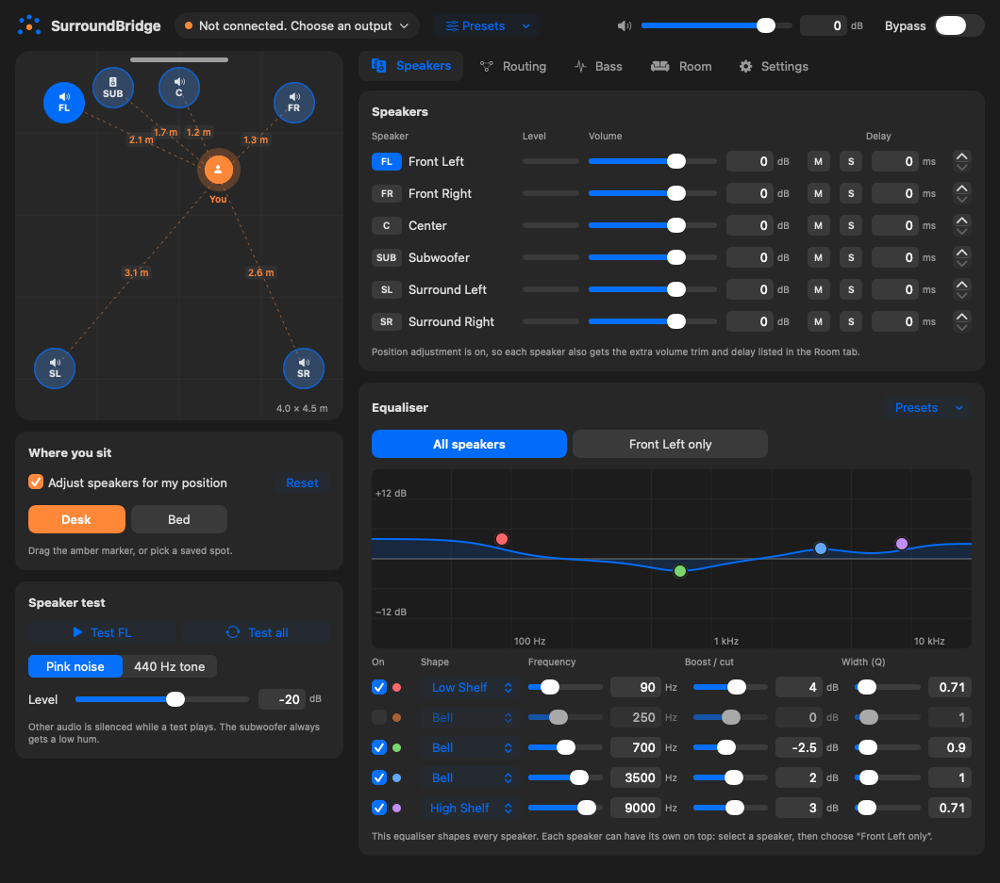
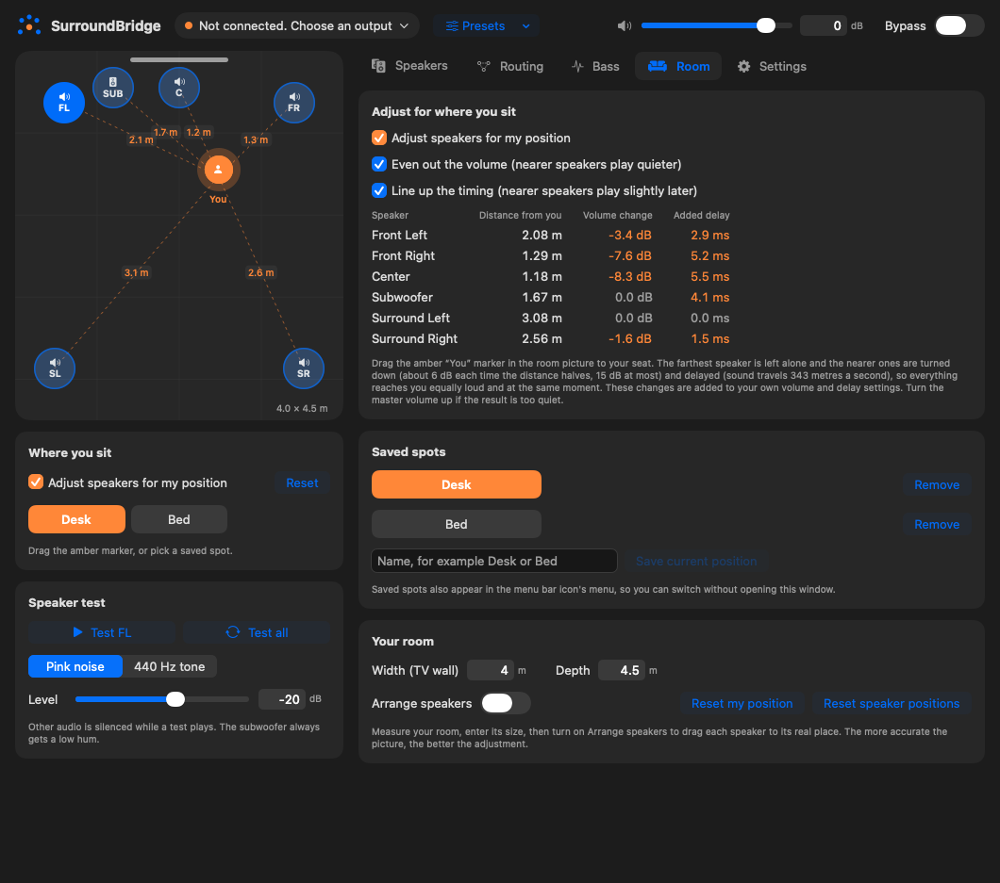

# SurroundBridge

A macOS app that gives you full control over what a 5.1 speaker system plays, even when the only
connection to it is HDMI/ARC or optical (which can't carry 5.1 as plain audio).

It captures your Mac's sound as 5.1, runs it through your own settings, encodes it to Dolby Digital
(AC-3) in real time and sends that to the TV / receiver.

```
Mac apps → "SoundPusher Audio" virtual 5.1 device → capture
        → routing → bass management → EQ → volume → delay → limiter      (SurroundCore)
        → AC-3 encoder (FFmpeg) → HDMI / optical → your speakers
```

**Turn the volume down before first use.** If any device misreads the Dolby Digital stream as
normal audio you get loud static.

## Features
- Routing matrix (any source channel → any speaker, with level and phase), plus receiver-style sound
  modes: Direct 5.1, All Channel Stereo, Matrix Surround, Stereo 2.0 / 2.1, Front Stage 3.1,
  Phantom Center, 5-Channel Mono
- Per speaker: volume, mute, solo, delay and a 5-band parametric EQ with a draggable curve
- An "All speakers" (master) EQ on top, and ready-made EQ presets
- Room & Position: draw your room, drag "You" to your seat, and the app balances each speaker's volume
  and timing for that spot. Save spots (Desk, Bed, ...) and switch from the menu bar
- Every slider has a number box you can type into
- Bass management: adjustable crossover that moves low frequencies to the subwoofer
- Safety limiter so nothing clips
- Test signal on one speaker at a time, or walking around the room
- Live level meters, presets you can save and load, menu bar control



## Requirements
- macOS 14.2 or later on an Apple Silicon Mac
- [Xcode](https://apps.apple.com/app/xcode/id497799835) (free), opened at least once
- An output device that accepts a Dolby Digital (AC-3) stream, such as a TV or receiver on HDMI or
  optical. To check, run `swift scripts/list-audio-formats.swift` and look for `cac3` under your device.

## Install
There is no ready-made download yet: an app that installs an audio device has to be signed with a
paid Apple Developer ID before macOS lets other people open it. Until then, you build it yourself,
which one script does for you:

```sh
git clone https://github.com/Viv-411/SurroundBridge.git
cd SurroundBridge
scripts/install.sh
```

The script builds FFmpeg and the app, copies SurroundBridge to `/Applications`, and installs the
virtual 5.1 audio device (it asks for your password once, and sound cuts out for a second).
Run it again after `git pull` to update. `scripts/uninstall.sh` removes everything.

## First run
1. **Turn your speaker volume down.**
2. Open SurroundBridge from Applications. Allow the two permission requests (system audio and
   "microphone", which is how macOS labels reading from the virtual device; your real microphone
   is not used).
3. Click **Not connected. Choose an output** and pick `SoundPusher Audio → <your TV or receiver>`.
4. Play something and press **Test all**: the noise should walk around your speakers.
5. In the Room tab, enter your room size, arrange the speakers, and drag "You" to your seat.

Settings has a **Start SurroundBridge when I log in** switch.



## Good to know
- **Delay:** expect roughly a quarter of a second between the Mac and the speakers. Dolby Digital
  encoding, the TV and the receiver all add to it. Fine for music; video players may need their
  audio-delay setting; not great for games.
- **Stereo sources** (most music) only contain left and right. Use a sound mode such as All Channel
  Stereo to fill the room, and bass management to feed the subwoofer.
- If you have no Apple Development certificate, the build is "ad-hoc" signed and macOS asks for the
  audio permissions again after each rebuild. This path has had less testing.

## For developers
- Build only: `scripts/build.sh` (output in `build/Release`)
- Unit tests for the audio maths: `cd Core && swift test`
- Regenerate the icons: `swift scripts/make-icons.swift`

## Layout of this repository
| Folder | What it is |
|---|---|
| `Core/` | SurroundCore: the audio processing engine (C++ with a C interface) and its tests |
| `SurroundBridge/` | The SwiftUI window, menu bar additions and settings model |
| `SoundPusher/` | SoundPusher's capture → encode → output engine, with small hooks for SurroundBridge |
| `SoundPusherAudio/` | SoundPusher's virtual 5.1 audio device (unchanged) |
| `scripts/` | Build scripts and test-file generators |

## Credits
SurroundBridge is built on **[SoundPusher](https://codeberg.org/q-p/SoundPusher) by Daniel Vollmer**
(MIT license), which provides the virtual audio device, the audio capture, the real-time AC-3
encoding and the digital output. Its original README is kept in
[SOUNDPUSHER-README.md](SOUNDPUSHER-README.md).

Also used: [FFmpeg](https://ffmpeg.org) (AC-3 encoder and S/PDIF muxer),
[TPCircularBuffer](https://github.com/michaeltyson/TPCircularBuffer) by Michael Tyson, and filter
formulas from Robert Bristow-Johnson's Audio EQ Cookbook.

## License
MIT, see [LICENSE](LICENSE).
